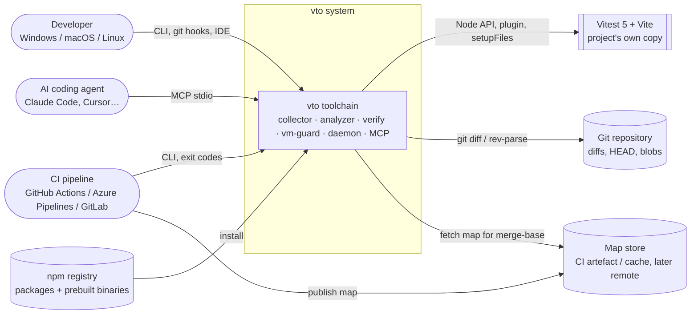
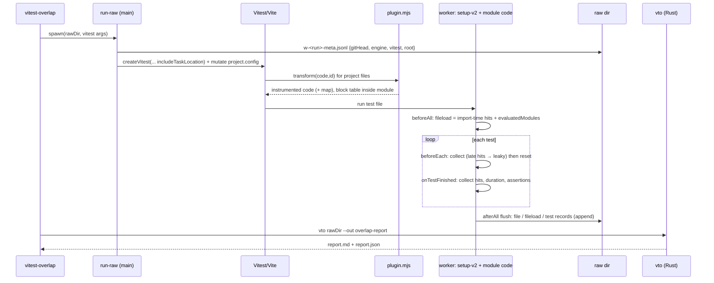
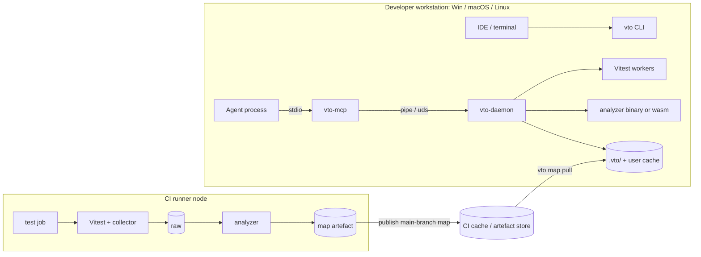

# vto – solution architecture (review draft 1)

Author: independent solution architect (did not build the code). State reviewed: git `00a4b2f` plus the untracked
`mcp/` directory (only `package.json`, `src/platform.mjs` and `src/diff.mjs` existed at the time of writing).
No production code was changed. Scratch experiments are in `/home/claude/arch-scratch/`.

Notation: **[M]** = measured in this repo (source given), **[E]** = estimate, **[GAP]** = not measured yet / missing.

---

## 1. Context, goals and quality attributes

### 1.1 Problem and goals

A React/TS team keeps a Vitest suite of about 3,400 tests that runs for more than 200 s. Humans and AI agents
pay for that on every iteration: in wall time, in CI minutes, and, for agents, in tokens spent reading logs.
vto is meant to make that loop much cheaper. It has five capabilities:

| # | capability | component | maturity |
|---|---|---|---|
| G1 | Fast **safe pools**: run the full suite in a fraction of the time with failures identical to `forks` | `vm-guard/` | working, measured on a 312-file fixture |
| G2 | **Test impact analysis**: run only the tests a change can affect (`vto affected`) | `collector/` + `analyzer/src/affected.rs` | working, safety-validated on a 43-test fixture only |
| G3 | **Overlap detection**: find redundant or near-duplicate tests as review candidates | `analyzer/src/analysis.rs`, `report.rs` | working, precision is low unless signals are added |
| G4 | **Mutation verification** of overlap candidates (`vto verify`) | `verify/` | working on one fixture |
| G5 | **Agent loop**: daemon with warm Vitest, MCP server, token-frugal answers | `MCP.md`, `mcp/` | design plus first files |

Non-goals for 1.0: replacing Vitest, browser-mode/Playwright coverage, Jest support, and any automatic
deletion of tests.

### 1.2 Quality attributes and measurable targets

| QA | scenario / metric | target for 1.0 | measured so far | status |
|---|---|---|---|---|
| **Performance: full run** | full suite CPU vs `forks` baseline, same machine | ≥ 80 % less CPU in `vm` mode, with failures identical to forks | heavy fixture, 312 files / 3,193 tests: forks 480–507 s, vm-guard `vm` 65.6–67.2 s (**−86 %**), `shared` 16.1 s (**−96.7 %**), same 5 failures [M] `vm-guard/README.md` "Celá heavy sada", `perf/RESULTS.md` §5 | met on fixture. **[GAP]** the user's real suite, and Windows/macOS |
| **Performance: agent iteration** | edit one component, then get test feedback (p50 / p95 wall) | p50 ≤ 15 s, p95 ≤ 45 s on the user's suite (warm daemon) | `--changed` on fixture: 8 of 312 files for one component [M] `perf/RESULTS.md` §4. Fault injection: mean **16 %** of tests selected [M] `analyzer/faultinject/last-result.json` | **[GAP]** no end-to-end measurement. The daemon does not exist yet |
| **Correctness: `affected` recall** | every test that fails after a change is selected (or exit 3) | **100 %** on ≥ 500 mutants across the user's repo plus 2 OSS repos, plus a replay of ≥ 200 historical commits | 60 mutants / 43 tests, recall 1.0, 0 misses, 2 run-all [M] `analyzer/faultinject/last-result.json` | small sample. **[GAP]** real repo, historical replay (REVIEW-1 §7.4) |
| **Correctness: `affected` precision (value)** | selected set compared with `vitest related` / `--changed` | vto ⊆ related always; median size ≤ 50 % of related | **[GAP]** never compared | must be measured. This is the value proposition (REVIEW-1 M10) |
| **Correctness: overlap verdicts** | precision of the "strong candidate" tier against labelled ground truth | ≥ 0.8 precision; the report never claims "removable" | coverage only: P 0.11 / R 1.0. coverage+assert+dom: P 0.60 / R 0.52. coverage+static: P 0.76 / R 0.34. assert → mutation pipeline: **P 0.81 / R 0.52** [M] `/home/claude/verify-fixture/results/vf-eval-*.json` | met only by the pipeline tier. Ground truth was labelled by the same team (REVIEW-1 M12) |
| **Overhead: collection** | v2 collection wall overhead vs a plain run in the same pool | ≤ 10 % wall, ≤ 0.5 ms/test | collect loop 0.19 ms/test at 150k blocks, 0.29 ms at 900k [M] REVIEW-1 §5. Signals +0.5 ms/test [M] `collector/setup-signals.mjs` header. V8 engine: +14.5 ms/test (≈10×) [M] REVIEW-1 §5 | **[GAP]** no end-to-end suite overhead number. `bench/bench.mjs` exists, but no result is recorded |
| **Overhead: vm-guard layer** | CPU over a bare pool | ≤ 5 % | vm +2.0–4.0 %, shared +3.5–5 % [M] `vm-guard/README.md` "Měření" | met |
| **Analyzer scale** | report for N tests | ≤ 1 s and ≤ 300 MB RSS at 10k tests; raw ≤ 50 MB per 10k tests | 3,174 tests: 45 ms total (parse 25, analysis 2.7, report 17) [M] this review (`/home/claude/arch-scratch/rep`). Raw 1.5 MB / 3,195 tests on the light fixture [M]. REVIEW-1 M9 estimates **~22 KB/test** (220 MB / 10k) for app-shell-heavy suites [E] | CPU met. Raw size **[GAP]**: hit interning is not implemented |
| **Output size** | report artefacts that humans and agents read | report.md ≤ 200 KB; agent answers ≤ 300 tokens by default, p95 ≤ 600 | report.json **3.1 MB**, report.md **891 KB** for 3,174 tests [M] this review (≈ 220k tokens) | **not met**. MCP must never return report files |
| **Token budget (MCP)** | tokens per tool response | rules of `MCP.md` §"Token budget" | **[GAP]** no server yet | add CI token tests (§3 ADR-8) |
| **Portability** | Win/macOS/Linux × Node LTS × supported Vitest minors | green CI matrix | everything was measured on Linux, 2 shared cores, Node 22, Vitest 5.1.1 [M] `perf/RESULTS.md` header | **[GAP]**: Windows and macOS have never run. No CI exists |
| **Security** | local-only, least privilege, no telemetry | no network calls; IPC reachable only by the same OS user; maps are data, never code | no network code found. IPC is planned in `mcp/src/platform.mjs` (`endpointFor`) | **[GAP]**: socket/pipe ACLs, secret redaction in console output |
| **Maintainability** | effort to absorb a Vitest minor; internal-API surface | all Vitest internals behind one adapter, with probe tests per capability | ≈ 25 internal touch points spread over 9 files (§4) | not met |

---

## 2. Architecture views

### 2.1 System context (C4 level 1)



Actors:
- **Developer**: runs `vitest` through vm-guard, `vto affected`, and the overlap report.
- **AI agent**: talks only to the MCP server and needs small, deterministic answers.
- **CI**:
  - produces the authoritative map on the main branch;
  - uses `affected` on PRs with a fail-open policy (exit 3 ⇒ run all);
  - runs nightly `forks` + `verify`.
- **Git**: the source of truth for "what changed" and for the base version of files.

### 2.2 Containers and components (C4 level 2/3)

```mermaid
flowchart TB
  subgraph node[Node.js process: Vitest main]
    entry[vitest-overlap.mjs<br/>CLI entry]
    runraw[collector/run-raw.mjs<br/>createVitest + config overrides]
    plugin[collector/plugin.mjs<br/>Vite transform: oxc + magic-string]
    vmcfg[vm-guard defineVmGuardConfig<br/>index.mjs]
    vrun[verify/runner.mjs + plugin.mjs<br/>mutant schemata]
  end
  subgraph worker[Vitest worker: thread / fork / vm context]
    setup[collector/setup-v2.mjs<br/>reset / collect per test, fileload]
    sig[collector/setup-signals.mjs<br/>assertHash, domHash]
    vmsetup[vm-guard/setup.bundle.mjs<br/>realm shims, leak detector, resets]
    vset[verify/setup-verify.mjs<br/>task.repeats per mutant]
    code[instrumented project modules<br/>__vto_reg Uint8Array per file]
  end
  raw[(raw store<br/>w-*.jsonl in tmp or --raw)]
  ana[analyzer/ Rust CLI vto<br/>raw.rs → model.rs → analysis / affected / imports / report]
  rep[(overlap-report/<br/>report.md, report.json)]
  ver[verify/verify.mjs<br/>plan, kill matrix, verdicts]
  vg[vm-guard CLI<br/>check · verify · plan · run · hunt · scan]
  vgstate[(.vm-guard/*.json<br/>quarantine, conflicts, durations)]
  daemon[vto daemon<br/>warm Vitest, incremental map]
  mcp[vto MCP server<br/>stdio, token rules]
  vstate[(.vto/<br/>map snapshot, blobs, socket meta)]
  hooks[Claude Code hook / git hooks]

  entry --> runraw --> plugin
  runraw -- setupFiles unshift --> setup
  plugin -- transforms --> code
  code -- hits --> setup
  sig --> setup
  setup -- appendFileSync --> raw
  entry -- spawn --> ana
  raw --> ana --> rep
  rep --> ver --> vrun --> vset
  vmcfg --> vmsetup
  vg --> vgstate
  vg -- --vto-raw fileload.modules --> raw
  mcp -- JSON-RPC over socket / pipe --> daemon
  hooks --> mcp
  daemon -- Node API --> runraw
  daemon -- child process --> ana
  daemon --> vstate
```

| component | responsibility | key files |
|---|---|---|
| CLI entry | arg parsing, finding the analyzer binary, temp raw dir, exit-code policy | `vitest-overlap.mjs` |
| Collector runner | loads the user's config via `createVitest`, injects the plugin and setup file, forces `includeTaskLocation`, `maxConcurrency:1`, coverage off; refuses browser mode | `collector/run-raw.mjs` |
| Instrumenter | pure `instrument(code, file)`: block markers at original positions, hoisted accessor (import cycles), name-preserving, pragma, block table embedded in the module | `collector/plugin.mjs` |
| Collector setup | per-test reset/collect, `fileload` (import-time hits, evaluated modules, `loadMs`), leaky/tainted flags, buffered JSONL flush per file | `collector/setup-v2.mjs` |
| Signals (opt-in) | assertion fingerprint via chai prototype wrap, DOM hash before RTL cleanup | `collector/setup-signals.mjs`, `verify/signals-setup.mjs` |
| V8 fallback | v1 engine via inspector precise coverage + source maps | `collector/setup.ts`, `analyzer/src/v1.rs`, `sourcemap.rs`, `flatten.rs` |
| Analyzer | parallel JSONL load, unit identity (file, name, line), identical / subset / near (prefix-filtered Jaccard), greedy cover statistic, unused imports, `affected` | `analyzer/src/*.rs` |
| Verify | mutant generation (oxc), schemata module per file, in-worker repeats per mutant, watchdog, verdicts and evaluation | `verify/*.mjs` |
| vm-guard | config wrapper (vm / shared / isolated), realm shims, outer-realm leak detection, resets, quarantine, conflict planner, lanes, bisection | `vm-guard/src/*.mjs` |
| Daemon (planned) | warm Vitest, run queue, incremental map patch, invalidation, idle shutdown | `MCP.md`, `mcp/src/platform.mjs`, `mcp/src/diff.mjs` |
| MCP server (planned) | stdio MCP tools; summary-first, paginated, relative ids | `MCP.md` |
| Hooks (planned) | Claude Code PreToolUse redirect from `npm test` to `run_affected`; git pre-push | `MCP.md` "Typical agent loop" |

### 2.3 Data flows

**Flow A: record the map (collect).**



**Flow B: affected.** `vto affected <raw> --git <base>` runs `git diff -U0 -M` with a pinned prefix and quoting
config (`analyzer/src/main.rs` `run_affected`), adds untracked files, maps the old-side lines to all overlapping
blocks (broad by default), and widens to file level through `fileload.modules`. It exits 3 on unknown files,
config files or missing data (`affected.rs`).

**Flow C: verify.** report.json + raw → candidate pairs → mutants within blocks covered by candidates → one
Vitest run with schemata modules. Each test repeats once per mutant (`setup-verify.mjs`) → kill matrix →
verdicts (`verify.mjs`).

**Flow D: agent loop (planned).** MCP `run_affected` → daemon → affected selection against the persisted map,
with a diff from `.vto/blobs` (no git needed, `mcp/src/diff.mjs`) → warm Vitest rerun → the hits of the re-run
tests patch the map → compact summary.

### 2.4 Raw data contract: assessment

The contract (`FORMAT.md`, v2 + addendum A) has several strengths:
- line-oriented and append-only;
- one file per worker, so no locking;
- every field beyond the core is optional, and the analyzer degrades safely;
- block positions are original source positions, so no source maps are needed;
- a random `runId` in file names makes shards mergeable.

Defects to fix before 1.0 (all verified in code):

| # | defect | evidence | consequence | fix |
|---|---|---|---|---|
| C1 | **No format version.** The `meta` record carries `engine` and `vitest`, but no schema version | `collector/run-raw.mjs` meta write; `/home/claude/arch-scratch/raw-vm/*meta*` | a future collector/analyzer mismatch is silent | `{"t":"meta","format":"vto-raw/2.1",...}`; the analyzer refuses unknown majors |
| C2 | **`meta.setupFiles` is never written**, although `affected.rs` uses it for run-all triggers | meta is written before `createVitest` (run-raw.mjs); no `setupFiles` key in actual output | setup files named e.g. `test/setup.ts` are not run-all triggers. Today this is safe only because the setup file also appears in every `fileload.modules` (seen in `/home/claude/bench-raw`) | write a second meta record after the project loop |
| C3 | **Absolute, machine-specific paths** in every record | `file`, `testFile`, hit keys are absolute (`setup-v2.mjs`) | maps cannot be shared between CI (`/home/runner/...`) and Windows dev boxes (`C:/src/...`) without re-rooting | persisted map stores repo-relative paths plus `repoRoot` in meta |
| C4 | **No per-file content hash / dirty flag**; validity = `gitHead` only | no hash/dirty code in `collector/`; REVIEW-1 M10 still open | a map recorded on a dirty tree, or on the wrong base, gives wrong line mappings with only a warning | store `sha1(normalised source)` per `file` record + `dirty` in meta. On mismatch, treat the file at file level (already planned in `MCP.md` "Map validity") |
| C5 | Raw is not interned (REVIEW-1 M9) | `setup-v2.mjs` `finalize` | 220 MB per 10k tests on app-shell suites [E] | `{"t":"set"}` interning or bitsets |
| C6 | Raw doubles as the "map" | `vto` re-parses all JSONL on every call | 25 ms now; seconds at scale; the daemon needs random access | introduce a **persisted map** (compact, versioned, relative) as a separate data object; raw becomes a transfer format |

---

### 2.5 Deployment per OS

Target packaging (today everything is `private: true`, in three separate `package.json` files with conflicting
ranges, see §6):

| artefact | contents | how installed |
|---|---|---|
| `vto` (npm, JS) | CLI shim, collector, verify, daemon, MCP server | `npm i -D vto` |
| `@vto/analyzer-<os>-<arch>` (npm, optional deps) | static Rust binary: win32-x64-msvc, win32-arm64-msvc, linux-x64-gnu, linux-x64-musl, linux-arm64-gnu, darwin-arm64, darwin-x64 | `optionalDependencies` (oxlint/biome pattern, REVIEW-1 M11). `mcp/src/platform.mjs` `analyzerCandidates` already expects `@vto/analyzer-<platform>-<arch>` |
| `@vto/analyzer-wasm` | `wasm32-wasip1` build run via `node:wasi` | fallback for `--omit=optional`, odd platforms and corporate mirrors that drop binaries |
| `vm-guard` (npm, JS) | independent package, own semver | `npm i -D vm-guard` |

Where state lives (today, plus the recommended layout):

| state | today | recommended | VCS |
|---|---|---|---|
| raw JSONL | `os.tmpdir()/vto-raw-*` or `--raw` (`vitest-overlap.mjs`) | unchanged (transient) | no |
| copied setup file | `<project>/node_modules/.vto/` or `<project>/.vto-tmp/` (`run-raw.mjs`) | `<project>/node_modules/.cache/vto/` (convention), or serve via a virtual module from the plugin | no |
| instrumented module cache | Vitest `fsModuleCache`, keyed by plugin name + hash (`plugin.mjs` VERSION) | unchanged, but probe-tested (§4) | no |
| overlap report | `./overlap-report/` | unchanged | no |
| daemon state | `.vto/` (map snapshot, blobs); socket `<tmp>/vto-<hash>.sock` or `\\.\pipe\vto-<hash>` (`mcp/src/platform.mjs`) | `.vto/` per project; maps fetched from the remote store go to the user cache dir: `%LOCALAPPDATA%\vto`, `~/Library/Caches/vto`, `$XDG_CACHE_HOME/vto` | `.vto/config.json` only |
| vm-guard | `.vm-guard/{incompatible,conflicts,pollution,durations}.json` committed; `run/`, `plan.json`, `files-cache.json` ignored (`vm-guard/README.md` "CLI") | unchanged | committed subset |

Per-OS notes:
- **Windows:**
  - Use a named pipe. Its default DACL must be restricted to the current user SID (Node's `net.createServer` does not do this by default) **[GAP]**.
  - Kill process trees with `taskkill /T` (already in `platform.mjs` `killTree`).
  - Build the binary with static CRT on native MSVC runners.
  - Case-folded paths are handled in `paths.rs` `fold_key` and `platform.mjs` `isCaseInsensitiveFs`.
  - `autocrlf` is handled by `normText` and by the CRLF corpus cases 047/048.
- **macOS:**
  - `sun_path` is 104 bytes. Already handled with a short tmp socket path in `endpointFor`.
  - APFS is case-insensitive by default, and this is detected rather than assumed.
  - A plain CLI binary installed via npm does not need notarization, but the CI must sign it if the company's MDM requires that **[GAP]**.
- **Linux:**
  - Create the socket with mode `0600` inside a `0700` directory. Do not create it in world-writable `/tmp` directly (current fallback).
  - Ship both glibc and musl builds (Alpine CI images).



### 2.6 ArchiMate mapping

| ArchiMate element | type | vto element |
|---|---|---|
| Developer | Business Actor | human developer |
| Coding Agent | Application Component (external) serving Business Role "Delegated developer" | Claude Code / Cursor |
| CI Pipeline | Application Process (on Node "CI Runner") | PR job, nightly job, map publish |
| Test Feedback | Business Service | "tell me which tests my change breaks, fast and briefly" |
| Coverage Recording | Application Service | realised by Collector Plugin + Collector Setup |
| Overlap Analysis | Application Service | realised by Analyzer |
| Test Impact Analysis | Application Service | realised by Analyzer (`affected`) + Daemon |
| Mutation Verification | Application Service | realised by Verify Engine |
| Safe Fast Execution | Application Service | realised by vm-guard |
| Agent Test Feedback | Application Service | realised by MCP Server + Daemon |
| Collector Plugin, Collector Setup, Analyzer, Verify Engine, vm-guard, Daemon, MCP Server, vto CLI, Hooks | Application Components | as in §2.2 |
| CLI, MCP (stdio), Daemon IPC (JSON-RPC over socket/pipe), Vite Plugin API, Vitest setupFiles hook, Report files | Application Interfaces | — |
| Raw Record Stream, Coverage Map, Overlap Report, Verify Report, Quarantine List, Conflict Graph, Durations, Blob Store | Data Objects | `w-*.jsonl`, `.vto/map`, `report.{md,json}`, `verify.{md,json}`, `.vm-guard/*.json`, `.vto/blobs` |
| Node.js runtime, Vitest/Vite framework, Rust native binary / WASM module, Git | System Software | — |
| Developer Workstation (Win/macOS/Linux), CI Runner | Nodes (Device + System Software) | — |
| npm registry, Map store | Technology Services | package distribution, map sharing |
| Raw JSONL file, analyzer binary, npm tarball | Artifacts | realise the Data Objects / Components above |

Relationships worth modelling explicitly:
- Analyzer *accesses* (read) Raw Record Stream; Collector *accesses* (write) it.
- Daemon *serves* MCP Server via Daemon IPC.
- vm-guard *accesses* Raw Record Stream (`--vto-raw`, `fileload.modules`). This is the only coupling between the vm-guard product and the vto product, and it should stay that narrow.
- Collector Plugin *depends on* (serving) "Vite Plugin API". Collector Setup *depends on* the "Vitest Runner internals" interface (§4). Model the latter as a separate Application Interface named "Vitest internal (unsupported)", so the coupling risk is visible in the model.

---

## 3. Architecture decision records (ADR-lite)

### ADR-1: Own instrumentation (v2) instead of V8 precise coverage
- **Context:** `Profiler.takePreciseCoverage` serialises the whole isolate (React, jsdom…) per test, which cost **+14.5 ms/test, ≈10×** [M] (REVIEW-1 §5). Source-map back-mapping is required, and coverage cannot be reset per test cheaply.
- **Decision:** Instrument only project files with oxc-parser + magic-string. Markers write into a module-local `Uint8Array`. Block positions are original positions. V8 stays as `--engine v8` fallback (`FORMAT.md` v2).
- **Consequences:**
  - Collection cost drops to ~0.2–0.3 ms/test [M], with no inspector.
  - vto now owns a JS/TS instrumenter, which brings syntax risk. It is mitigated by the 90-case corpus (`collector/corpus/`) and selftest. B3 (cycles) is fixed with a hoisted accessor.
  - The plugin must run first (`plugin.mjs` `configResolved`), and code changed by an earlier plugin is skipped with a warning. So React-Compiler files are measured uncompiled, or not at all.
  - The instrumenter can be reused by other runners (§5).
- **Verdict: agree.** Two follow-ups are needed:
  1. Implement the **differential V8 ↔ v2 oracle** from REVIEW-1 §7.1. Run it in CI on the corpus and on one real app. This is the only independent check of the instrumenter.
  2. Decide whether the V8 fallback is a product feature. It doubles the analyzer surface (`v1.rs` 627 lines, `sourcemap.rs`, `flatten.rs`). **Recommendation:** keep it as a dev-only oracle and drop it from the user-facing CLI for 1.0.

### ADR-2: Analyzer in Rust, distributed as a CLI binary
- **Context:** The user asked for "lightning fast (Rust or Zig)". The analysis involves set-similarity joins that can go quadratic.
- **Decision:** A Rust 2024 crate `vto` with rayon, serde and FxHash, run as a child process (`vitest-overlap.mjs` `findAnalyzer`). The planned distribution is per-platform npm packages (REVIEW-1 M11; `mcp/src/platform.mjs`).
- **Consequences:**
  - 3,174 tests are analysed in 45 ms, of which the analysis itself is **2.7 ms** [M]. Parsing JSON dominates.
  - The cost is a seven-target build matrix, toolchain pinning, binary provenance, and the corporate-mirror problem (optional deps get stripped).
  - The Node side (verify, vm-guard, daemon) already re-implements raw parsing in JS (`verify/verify.mjs` reads `w-*.jsonl` itself). This is a second, independent reader of the contract.
- **Verdict: agree with Rust, but challenge the distribution plan.**
  - At the user's scale, the analysis is milliseconds. The binary matrix is pure operational cost that the value doesn't justify.
  - Make **WASM (wasm32-wasip1) the default shipped artefact** (one file, works everywhere Node runs, 1.5–3× slower, so still well under 1 s). Make native binaries an optional speed-up.
  - Add a **`vto serve` mode** (JSON-RPC over stdio) so the daemon keeps the model in memory instead of re-parsing JSONL per request. This settles the "napi vs child process" open question in `MCP.md`: child process + long-lived server mode. There is no napi ABI matrix, and the in-memory speed is the same.
  - Make the Rust crate the **only** reader of the raw contract. `verify.mjs` should consume analyzer output (`report.json` or `vto serve` queries), not raw JSONL.

### ADR-3: Block-based coverage map
- **Context:** The analysis needs atoms finer than lines (`&&` arms in JSX, implicit `else`, `default`).
- **Decision:** Atoms are (file, block id). Blocks are function bodies, statement continuations after compound statements, branch arms, short-circuit-taken arms, default values (`plugin.mjs` `visit`). Ids are positional indices in the block table. The table hash guards registry reuse.
- **Consequences:**
  - The map is precise and compact.
  - Ids are **unstable across edits**: any edit renumbers the blocks after it. Incremental map patching (the daemon) must re-key the rows of tests that did not re-run. `mcp/src/diff.mjs` (line remap via Myers diff) is the right direction.
  - Top-level code has no blocks, which is covered by `fileload` (ADR-4).
- **Verdict: agree.** Add a **stable block key** in the persisted map, e.g. `(kind, normalised-span-text hash, ordinal among equal hashes)`. Then unchanged functions keep their identity across edits, and the incremental map can carry over rows without re-running tests.

### ADR-4: Affected selection from the coverage map, broad mapping, file-level widening
- **Context:**
  - REVIEW-1 showed that "innermost block" mapping misses tests (B2), and that top-level code is never attributed (B1).
  - Safety (100 % recall) is the overriding requirement.
- **Decision:**
  - A changed old-side line selects **all blocks overlapping it**. `--innermost` is experimental.
  - A change in top-level or import-time code, a module without blocks, or a deleted file selects every test file whose `fileload.modules` contains the file.
  - Unknown, new or config files trigger exit 3, which means run all (`affected.rs` header and `DEFAULT_RUN_ALL`).
- **Consequences:**
  - Recall was 1.0 on 60 mutants, with a mean selection of 16 % [M].
  - Selection is coarser than ideal: an enclosing function body block selects every test that entered the function.
  - Precision depends on how often changes land in top-level code. React modules often hold `styled`, `createContext`, route tables and constants at top level.
- **Verdict: agree on the safety posture. Challenge the evidence base and the positioning.**
  1. A 43-test fixture with single-line mutations is not evidence for a 3,400-test app. Multi-line refactors, renames and moved code are absent from it. Run the historical-replay protocol (REVIEW-1 §7.4) on the user's repo **before** anyone in the company relies on it in CI.
  2. Vitest 5 already ships file-level TIA: `--changed`, `related`, `experimental.recordDependencies` + `--sinceLastRun` (`perf/RESULTS.md` §4). vto must (a) always be a **subset of that set**, which is a free safety oracle, and (b) report the ratio. If the ratio on the user's repo is ≥ 0.7, the block-level map does not pay for its complexity in CI, and the product value shifts to G1 and G5.
  3. Prefer Vitest's public dependency recording over `__vitest_worker__.evaluatedModules` (§4) as the source of `fileload.modules`, wherever it exists.
  4. Non-code inputs that tests read at run time (`readFileSync` fixtures, `import.meta.glob`, MSW handler files loaded through aliases, `process.env`) are visible only if they are modules. Add a run-all rule for "file under a test-fixture glob" and document the residual risk.

### ADR-5: Mutation verification with schemata, in-process repeats
- **Context:** Coverage equality is a weak redundancy signal: precision 0.11 at recall 1.0 [M]. Classic per-mutant Stryker-style runs are too slow.
- **Decision:**
  - All mutants of a file go into one module, guarded by `globalThis.__vto_mut === id` (`verify/mutate.mjs` `applySchemata`).
  - One Vitest run. Every planned test gets `task.repeats = n+1`, and attempt *i* activates `schedule[i]`, with a baseline attempt first and last (`setup-verify.mjs`).
  - Failing mutant attempts are rewritten to `pass` so the reporter stays quiet.
- **Consequences:**
  - The whole verification of 158 tests / 2,109 test×mutant runs fits in one Vitest process in 43–154 s [M] (`vf-verify-*/verify.md`).
  - Precision alone is still only 0.28–0.34. Combined with assertion fingerprints, the pipeline reaches **P 0.81 / R 0.52** [M].
  - Verify depends on the **deepest Vitest internals in the repo**: mutating `task.repeats`, `task.retry`, `task.mode` at run time, and overwriting `task.result.state` and `errors` (§4).
- **Verdict:**
  - **Agree with schemata.** Schemata are standard practice (Stryker uses them) and the measured speed-up is real.
  - **Disagree with rewriting results.** Replace it with either a custom runner (`runner:` option extending the public `VitestTestRunner`, owning repeat scheduling) or a custom reporter plus vto-owned exit-code logic. Leave `task.result` untouched.
  - Position verify as a **nightly / on-demand** tool, not part of the inner loop.
  - The 0.52 recall means the pipeline misses half of the true redundancies. That is acceptable, because the report only proposes review candidates.

### ADR-6: vm-guard: `vm` mode default, `shared` with `resetModules` opt-in
- **Context:**
  - Module-graph and environment re-evaluation per file is ≥ 80 % of CPU (`perf/RESULTS.md` §0).
  - Bare `isolate:false` breaks `vi.mock` across files: 308–311 failures on the full suite [M].
- **Decision:**
  - `defineVmGuardConfig` adds `pool: vmThreads`, realm `Symbol.hasInstance` shims, missing web globals, an outer-realm leak detector, `process.env` restore, and quarantine into `forks` projects.
  - The `shared` mode uses `threads` + `isolate:false` + per-file `vi.resetModules()` + resets, with a conflict planner and self-healing bisection (`vm-guard/src/*`, README).
- **Consequences:**
  - vm: −86 % CPU, shared: −96.7 %, both with failures identical to forks [M].
  - The shims make vm **more tolerant** than forks, so false greens are possible. A nightly `forks` run + `vm-guard verify` is mandatory (README "Co vrstva nepokryje").
  - `test.projects` configs are refused (`index.mjs:53`), which is a blocker for many company repos.
- **Verdict: agree.** This is the component with the best evidence and the fastest payoff. Ship it first, as a separate package with its own semver.
  - Add `projects` support (wrap each project).
  - Publish the README in English.
  - Add an interaction test with the vto collector. This review found that `collector/setup-v2.mjs` registers `process.on('exit')` **once per test file** under `vmThreads`, because its state lives on the context `globalThis` while `process` is the shared outer realm. Running 117 files gave `MaxListenersExceededWarning: 11 exit listeners` [M] (`/home/claude/arch-scratch/bs`). Each listener closes over that file's context, so contexts are likely retained (heap growth not measured). vm-guard's own leak detector is designed to flag exactly this. Fix: keep collector state on the outer realm (`vm.runInThisContext('globalThis')`, as `vm-guard/src/realm.mjs` does) or register the listener once via a `Symbol.for` flag on `process`.

### ADR-7: Daemon with warm Vitest
- **Context:** The agent loop needs seconds, not 200 s (`MCP.md`).
- **Decision:**
  - One daemon per project root. IPC over a socket or named pipe, lazily started, with idle shutdown.
  - Warm `createVitest`. The collector is always on, the map is patched incrementally, and a list of invalidation triggers restarts it.
- **Consequences:**
  - Startup cost is paid once, and the map stays fresh.
  - It brings long-lived-process problems: memory growth in workers, a stale Vite module graph, config reloads, concurrent clients (`MCP.md` open questions), and orphaned processes on Windows.
- **Verdict: agree in principle. Challenge what it is expected to save.**
  - The measured cost is **per-file environment and module evaluation** (80 %), which a warm main process does not remove. Vitest 5's `fsModuleCache` (default on) already persists transforms across cold runs (`perf/RESULTS.md` §4).
  - The daemon saves config load + Vite startup (≈1–3 s [E]) and keeps the map in memory. That matters for an agent doing 30 iterations, but it is not where the 200 s go. The big wins are `affected` selection plus vm-guard `vm` mode, and **both work without a daemon**.
  - **Build order:** (1) a stateless `vto run-affected` CLI that uses vm-guard + affected + compact output. (2) The MCP server on top of the stateless CLI. (3) The daemon as an optimisation behind the same protocol, once measured.
  - Use only public rerun APIs of the Vitest Node API: `createVitest`, `vitest.runTestSpecifications` / `rerunTestSpecifications`. Make "collector always on" configurable. Instrumented code is not the code CI runs (ADR-1 consequence); make the agent's final `run_affected { base: origin/main }` run **without** instrumentation, or with vm-guard only.

### ADR-8: MCP token rules
- **Context:** An agent reading a full Vitest log, or report.md (891 KB ≈ 220k tokens [M]), wastes context.
- **Decision:** Summary objects ≤ ~300 tokens; passing tests are only counted; failures are compact (diff truncated, 3 project frames); short relative ids; grouping of identical errors; `stale`/`runAll` flags on every answer; paginated details (`MCP.md`).
- **Verdict: agree.** Make the rules enforceable:
  1. A token-budget test in CI: golden responses from the bench project, a tokenizer approximation, and a failing assertion when the p95 exceeds the budget.
  2. Version the tool schemas (`vto/1`). Return MCP `structuredContent` plus a one-line text summary.
  3. **Redact** console output and error messages: env-like `KEY=...`, bearer tokens, connection strings. Agent transcripts may be logged by third parties.
  4. Every answer must carry `mapAge` and `instrumented: bool`, so the agent knows what it ran.
  5. Never expose arbitrary Vitest CLI flags through MCP. Use typed filters only, and pass arguments as arrays, never as shell strings.

---

## 4. Coupling to Vitest internals

### 4.1 Inventory of non-public dependencies

Legend: **P** = public documented API, **S** = semi-public (exported or typed, but documented as advanced/experimental or behaviour-only), **I** = internal (undocumented global, private field, implementation detail). Risk = likelihood × impact on Vitest upgrades.

| # | dependency | where | class | what breaks if it changes | risk |
|---|---|---|---|---|---|
| V1 | `globalThis.__vitest_worker__.evaluatedModules.fileToModulesMap` | `collector/setup-v2.mjs:95-96` | I | `fileload.modules` loses non-instrumented modules (JSON/CSS/barrels) → **affected misses** for those files (wrapped in `try`, so the failure is silent) | **high** (silent recall loss) |
| V2 | `__vitest_worker__.evaluatedModules.idToModuleMap` | `analyzer/faultinject/run.mjs:69` | I | fault-injection shim | low (test tooling) |
| V3 | `globalThis[Symbol.for('expect-global')]` for `testPath` and `assertionCalls` | `setup-v2.mjs:90,136`; `setup.ts:93` | I | `testFile` falls back to `task.file.filepath` (OK); `assertions` becomes null | low–medium |
| V4 | `ctx._local` to choose a local `expect` | `setup-v2.mjs:136`; `setup.ts:93` | I | wrong `assertionCalls` with `test.extend`/local expect | low |
| V5 | `task.fullTestName` (fallback: own `fullName`) | `setup-v2.mjs:122`; `verify/setup-verify.mjs:45`; `verify/signals-setup.mjs:96` | S | id mismatch between collector and verify if one side falls back and the other does not | medium |
| V6 | **runtime mutation of `task.repeats`, `task.retry`, `task.mode`** in a setup-file `beforeAll` | `verify/setup-verify.mjs:47-50` | I | verify silently runs each test once (no mutants), or skips wrong tests | **high** |
| V7 | `task.result.repeatCount` as attempt index | `setup-verify.mjs:57` | I | wrong mutant activated per attempt → wrong kill matrix | **high** |
| V8 | **overwriting `task.result.state = 'pass'` and `errors`** in `onTestFinished` | `setup-verify.mjs:72` | I | reporters / exit code may see failures, or retries may trigger | **high** |
| V9 | hook ordering: setupFiles order × `sequence.hooks: 'stack'` × `onTestFinished` after all `afterEach`/fixture teardown; setup-file `beforeAll` runs after collection | `setup-v2.mjs` (comments, `beforeAll` fileload snapshot); verified in REVIEW-1 p2 | S (behaviour) | per-test attribution shifts (unmount effects lost, import-time hits mixed into first test) | **high** (silent precision/recall drift) |
| V10 | **mutating resolved `project.config`** after `createVitest` and before `start` (`setupFiles.unshift`, `includeTaskLocation`, `maxConcurrency`, `sequence.concurrent`, `coverage.enabled`, `retry`, `testTimeout`) | `collector/run-raw.mjs:95-117`; `verify/runner.mjs:73-80` | I | overrides ignored, e.g. if config is frozen or copied into workers earlier → concurrency taints everything or the collector is not loaded | **high** |
| V11 | `createVitest`, `parseCLI` from `vitest/node` | `run-raw.mjs:40,70,83`; `verify/runner.mjs:22,61` | S (advanced API) | runner cannot start | medium (loud failure) |
| V12 | Vite plugin hook `configureVitest`, `vitest.projects`, `project.matchesTestGlob`, `project.config.setupFiles`, `project.vite.config.plugins` | `collector/plugin.mjs:241-251`; `run-raw.mjs:109` | P/S | test files get instrumented (wrong overlap), or the plugin-attached check misfires | medium |
| V13 | **mutating `config.plugins` array in `configResolved`** to move vto first | `plugin.mjs` `configResolved` | I (Vite) | vto runs after other `pre` plugins → files skipped with warning (fail-safe) | medium |
| V14 | `fsModuleCache` cache key includes plugin names | `plugin.mjs:221` (`VERSION` in name); `verify/plugin.mjs:9` | I | **instrumented or mutant-schemata modules could be served to a plain run**, or stale instrumentation reused. Schemata are inert without `__vto_mut`, but instrumented code would run in CI | **high** (correctness of plain runs) |
| V15 | Vitest batching: with `isolate:false` + `maxWorkers:1`, all files go in one run request in sequencer order (`groupSpecs`) | `vm-guard/src/sequencer.mjs` header; README "Realizace" | I | lane order no longer equals execution order → planner and bisection become wrong | medium |
| V16 | `vmMemoryLimit` checked against `heapUsed` after each file; default `totalmem/maxWorkers` | `vm-guard/src/index.mjs` `autoMemoryLimit` | I (behaviour) | memory tuning becomes off. Performance only | low |
| V17 | vm pool realm layout: Node builtins and copied globals from the outer realm, `node_modules` evaluated per context | `vm-guard/src/realm.mjs`, `fingerprint.mjs` | I | shims become unnecessary or wrong; leak detector false positives | medium |
| V18 | `vi.resetModules()` keeps `node_modules` cached and resets only project modules | `vm-guard/src/setup.mjs:233` | S (documented behaviour) | shared mode becomes slow or unsafe | medium |
| V19 | `inject('vmGuard')` / `provide` | `vm-guard/src/setup.mjs:22` | P | — | low |
| V20 | `BaseSequencer` from `vitest/node` | `vm-guard/src/sequencer.mjs` | P | — | low |
| V21 | `vitest list --filesOnly --json` output shape; JSON reporter shape (`testResults[].assertionResults[]`) | `vm-guard/src/cli.mjs` `listFilesUncached`; `vm-guard/src/runner.mjs` | S | CLI cannot list or compare runs (loud) | medium |
| V22 | `TestContext.onTestFinished`, `task.location` with `includeTaskLocation` | `setup-v2.mjs` | P | — | low |
| V23 | Vitest/Vite id format (`/abs/path?query`, `\0` virtual ids, `/@fs/`) | `plugin.mjs` `handler` | S | wrong files instrumented or skipped | low–medium |
| V24 | `@testing-library/dom` resolved via `@testing-library/react`'s require path | `verify/setup-verify.mjs` | I (RTL layout) | `asyncUtilTimeout` not applied → verify slower | low |
| V25 | log scraping (`Tests N passed`) | `bench/bench.mjs` | I | bench numbers wrong | low (tooling) |

There are 25 touch points. Six are high risk (V1, V6–V8, V9, V10, V14), and **four of those fail silently**
(V1, V9, V10, V14), which is the dangerous kind for a tool whose promise is "safe".

### 4.2 Compatibility strategy

1. **Adapter layer.** Create `@vto/vitest-adapter` (one module per side, main and worker). It is the only code
   allowed to touch V1–V18. It exposes a small interface:
   - `getEvaluatedModules()`
   - `getAssertionCount(ctx)`
   - `testId(task)`
   - `scheduleRepeats(task, n)`
   - `suppressFailure(task)`
   - `overrideProjectConfig(project, patch)`
   - `ensurePluginFirst(config)`
   - `capabilities()`

   The collector, verify and vm-guard import only from the adapter. vm-guard can vendor its own adapter to stay independent.
2. **Capability probes, fail closed.** At startup, run a micro test file in a throwaway project (cost ≈ 1 s, cached per Vitest version). It asserts each behaviour:
   - hook order (V9);
   - config override honoured (V10);
   - `evaluatedModules` shape (V1);
   - `fsModuleCache` isolation (V14: run instrumented, then plain, and assert no `__vto_reg`);
   - repeats scheduling (V6/V7);
   - batching order (V15).

   If a probe fails, the affected capability **degrades safely**:
   - no module list → `affected` widens or runs all;
   - no config override → refuse to run;
   - repeats unavailable → verify uses `--strategy per-mutant`.

   The `capabilities()` result goes into the `meta` record, so the analyzer knows what it can trust.
3. **Replace internals with public APIs where one exists:**
   - V10: use the `config()` / `configureVitest` plugin hooks to add setupFiles and options, instead of mutating resolved config.
   - V1: use `experimental.recordDependencies` or the project module graph on the main side (`project.vite` environment module graph) instead of the worker global.
   - V6–V8: use a custom `runner` or a custom reporter.
   - V14: set a vto-specific `cacheDir` / disable `fsModuleCache` for instrumented runs, if the cost is acceptable. The measured effect of the fs cache on this fixture was 0 % (`perf/RESULTS.md` row 16), so turning it off for vto runs is cheap insurance.
4. **Version matrix CI:**
   - Rows: Vitest {lowest supported minor, latest minor, `beta`} × Node {20, 22, 24} × OS {ubuntu, windows, macos}.
   - Run on each row: the corpus (`collector/corpus/run.mjs`), the probe suite, fault injection (`analyzer/faultinject/run.mjs`, n=60), and vm-guard unit and lab subsets.
   - Run the `beta` row nightly. It is allowed to fail but must open an issue.
   - Let Renovate bump Vitest weekly.
5. **Honest peer ranges.**
   - Today the root package claims `vitest >=4` (`package.json`), but everything was measured on 5.1.1 only. vm-guard claims `>=5.1 <6`.
   - Declare `>=5.1 <6` everywhere for 1.0. Widen only when a matrix row proves it.
   - Refuse to run (exit 2) outside the range unless `VTO_UNSAFE_VITEST=1` is set.

---

## 5. Integration seams and extensibility

| seam | today | recommendation |
|---|---|---|
| **Other runners (Jest, Mocha, node:test)** | none. The raw contract is almost runner-neutral (no Vitest field names except `vitest` in meta) | Freeze the raw contract as runner-neutral (`runner: "vitest@5.1.1"` in meta). `instrument()` is a pure function, so it can be wrapped in a Jest transformer that runs **before** `ts-jest`/`babel-jest` (Jest allows one transformer per pattern, so the wrapper chains them). A Jest `setupFilesAfterEach` plus `testEnvironment` events give per-test reset/collect. Expect 2–3 weeks [E]. Not for 1.0 |
| **Vitest browser mode / Playwright component tests** | explicitly refused (`run-raw.mjs` "browser mode is not supported") | The instrumentation is runtime-neutral (`Uint8Array` on `globalThis`). In browser mode, collect through Vitest browser `commands` or `page.evaluate` at `onTestFinished`. Playwright CT: collect in a fixture after each test. The `affected` logic is unchanged. Post-1.0 |
| **Monorepos / Vitest `projects`** | collector: supported with `extends: true` projects (`run-raw.mjs:95-117`). vm-guard: **refuses `test.projects`** (`index.mjs:53`). `fileload.modules` filters to `f.startsWith(ROOT)` where `ROOT = cwd` (`setup-v2.mjs`) | (a) vm-guard wraps each project. (b) Use the **git top-level**, not `cwd`, as ROOT for module filtering. Otherwise, running from `packages/app` drops non-instrumented modules of sibling workspace packages from `fileload.modules`, which is a silent recall risk **[GAP: test it]**. (c) The per-project map lives in one file keyed by project name. (d) `affected` treats workspace `package.json` changes as run-all for that project only |
| **CI caching of the map** | none (raw lives in a tmp dir) | **Main branch:** collect nightly or on merge; publish `map-<sha>.vto` + `map-latest` keyed by `hash(lockfile, vitest/vite config, tsconfig*, setupFiles, vto version, vitest version)`. **PR:** `git merge-base origin/main HEAD`, then fetch the closest older map; the per-file content hashes (C4) decide what is still valid; `vto affected --git <map sha>`; exit 3 ⇒ full run. **Gate:** the full suite still runs on merge to main (or nightly). Provide templates for **GitHub Actions** (`actions/cache` / artefacts) and **Azure Pipelines** (`Cache@2` + pipeline artefacts) — the user's company is likely on Azure DevOps — plus GitLab |
| **Team-wide map sharing (remote cache)** | none | Phase 1: developers pull the CI artefact (`vto map pull --from <ci-artefact-url|dir>`). Phase 2: a git-native store (`refs/vto/maps/<sha>` or `git notes`) needs no infrastructure and is portable. Trust rules: accept maps only from protected-branch CI; never from fork PRs; validate the schema; the map is data only. A poisoned map can hide a failing test from a PR's `affected` run, so the merge gate must not rely on `affected` alone |
| **IDE integration** | none | Define the daemon protocol once (JSON-RPC 2.0 over the same socket/pipe). MCP, CLI and a VS Code extension are three thin clients. Extension features: "tests covering this line" (`coverage_of`), "run affected" code lens, overlap hints. Reuse the official Vitest VS Code extension for running tests, and add only vto queries |
| **Hooks** | planned (`MCP.md`) | Claude Code PreToolUse hook that maps `npx vitest run` / `npm test` to `run_affected`; git `pre-push` runs `vto affected --git @{u}`. Ship as copy-paste snippets plus `vto init` |
| **vm-guard ↔ vto** | vm-guard reads `fileload.modules` and `durationMs` (`--vto-raw`) | Keep it this narrow and document it as a published interface of the raw contract |

---

## 6. Gaps, risks and roadmap to 1.0

### 6.1 Gaps and risks (verified)

| # | gap / risk | evidence | impact |
|---|---|---|---|
| R1 | **No CI and no non-Linux run ever.** The target platforms are Win/macOS/Linux | no `.github/` or pipeline files; all numbers on Linux 2-core | Windows path, pipe and process-tree code is unproven (e.g. `paths.rs`, `platform.mjs`) |
| R2 | **Silent-degradation coupling** (V1, V9, V10, V14) | §4 | wrong `affected` answers without warning |
| R3 | **`affected` validated on a toy fixture only** | 43 tests, 60 single-line mutants | over-trust in CI; one missed regression destroys adoption |
| R4 | Collector leaks an exit listener per file in vm pools | `MaxListenersExceededWarning` (§3 ADR-6) | memory growth and noisy logs in the recommended pool |
| R5 | Raw/map contract: no version, absolute paths, no content hashes, `meta.setupFiles` missing | §2.4 C1–C4 | no sharing, stale-map errors, upgrade breakage |
| R6 | Output size (report.json 3.1 MB, report.md 891 KB at 3k tests) | §1.2 | unusable for agents; heavy for humans |
| R7 | Verify rewrites Vitest results | `setup-verify.mjs:72` | can break on any runner change; masks real failures if baseline detection fails |
| R8 | Inconsistent packaging: three private `package.json` files; root `files` omits the analyzer, so an npm install cannot run; engines `>=20` vs `>=22`; peer `vitest >=4` vs `>=5.1 <6` | `package.json`, `vm-guard/package.json`, `mcp/package.json` | not installable as a product |
| R9 | Language: reports and the vm-guard README are Czech only; code comments English | `report.rs`, `vm-guard/README.md` | fine for the first internal team; blocker for OSS / international colleagues |
| R10 | Open REVIEW-1 items: M2 (order-dependence shuffle pass), M4 (setup/body phase split, only `common_cutoff` exists), §7.1 differential oracle, §7.4 historical replay, M12 independence of ground truth | grep finds no `shuffle` / phase code; eval GT authored in-team | overlap precision ceiling; unknown instrumenter bugs |
| R11 | Security of local IPC: Windows named pipe default DACL; `/tmp` socket fallback | `mcp/src/platform.mjs` `endpointFor` | another local user could drive test runs (arbitrary code execution as the victim) on shared build boxes / terminal servers |
| R12 | Committed generated file `vm-guard/src/setup.bundle.mjs` with no freshness check | `vm-guard/scripts/bundle-setup.mjs` | the bundle and its sources drift apart |
| R13 | No LICENSE; IP ownership unclear | repo root | cannot legally share with the company or open-source it |
| R14 | Test coverage of the product itself: 30 Rust unit tests (`cargo test`, 0 in `raw.rs`/`report.rs`), vm-guard `node --test`, corpus 90 cases; collector setup logic has no unit tests | `cargo test` output | regressions in the most subtle code (hook timing) go unnoticed |

### 6.2 Prioritised roadmap

**Phase 0: make it shippable (blocks 1.0)**
1. **One product, one repo layout, one version.**
   - npm workspaces: `packages/vto` (CLI, collector, verify, MCP, daemon), `packages/vto-analyzer-*` (binaries), `packages/vto-analyzer-wasm`, `packages/vm-guard`.
   - Consistent `engines` (Node ≥ 20.19 or ≥ 22, decide once) and peer `vitest >=5.1 <6`.
   - Changesets for releases.
2. **CI matrix** (§4.2 item 4) on GitHub Actions *and* an Azure Pipelines template. Native release builds with static CRT on Windows, and SLSA/npm provenance.
3. **Vitest adapter + capability probes** (§4.2 items 1–3). Fix V10 (use plugin config hooks), V14 (vto-specific cache dir) and V6–V8 (custom runner or reporter).
4. **Raw contract 2.1 and persisted map:**
   - format version;
   - `meta.setupFiles`, `dirty`, `capabilities`;
   - per-file content hash;
   - repo-relative paths;
   - hit interning;
   - a JSON Schema in the repo, used by both the Rust reader and the tests.
5. **Fix R4** (outer-realm collector state) and add a vm-pool run of the corpus to CI.
6. **Safety evidence for `affected`:** fault injection with ≥ 500 mutants (multi-line too) and a 200-commit historical replay on the user's repo plus 2 OSS React repos. Gates: 0 misses, vto ⊆ `vitest related`, ratio reported. Publish the numbers in the README.
7. **Licence and IP.**
   - Decide **MIT or Apache-2.0**. All dependencies are permissive: oxc-parser and magic-string are MIT; rayon and serde are MIT/Apache; the MCP SDK and zod are MIT.
   - Clarify ownership with the employer **before** anything leaves the company. Under Czech law, work created as part of employment duties is typically an employee work whose economic rights the employer exercises.
   - Add `LICENSE`, `SECURITY.md`, and a third-party notices file.
8. **Telemetry-free by default.** State in the README that vto makes no network calls (true today). Add a CI test that fails on any `fetch`/`http` import outside an allow-list. Any future opt-in telemetry must be off by default and documented.
9. **Docs (English primary, Czech secondary):**
   - a quick start for each capability;
   - a rollout guide: vm-guard first (`vm-guard/README.md` "Doporučený rollout" is a good base);
   - "how to read the overlap report: candidates, not deletions";
   - a troubleshooting page with an exit-code table;
   - CI templates.

**Phase 1: 1.0 feature scope**
10. vm-guard 1.0: `projects` support, English README, interaction test with the collector. **Roll this out to the company first.** It has the strongest evidence and needs no map.
11. `vto run-affected` stateless CLI with compact output (the MCP response shape), plus CI templates with fail-open.
12. MCP server over the stateless CLI, with token-budget tests, redaction, and versioned schemas. The daemon only after measuring what it saves (ADR-7).
13. Report: size caps (`--top`, per-section limits are partly there), English/Czech templates, report.json split into `summary.json` + paged detail.

**Phase 2: after 1.0**
14. Daemon with JSON-RPC protocol, IDE extension, remote/git-notes map store.
15. Overlap precision work: setup/body phase split (M4), shuffle pass (M2), verify as nightly job.
16. Jest adapter; browser-mode / Playwright CT collection.
17. Drop or freeze the V8 engine (ADR-1).

### 6.3 What blocks 1.0 (go/no-go checklist)

- [ ] CI green on Windows, macOS and Linux for the corpus, probes, fault injection and vm-guard tests.
- [ ] All high-risk Vitest couplings either replaced with public APIs or covered by fail-closed probes.
- [ ] `affected`: 0 misses on ≥ 500 mutants + 200-commit replay on the user's repo; documented fail-open CI policy.
- [ ] Contract 2.1: versioned, relative paths, content hashes, `setupFiles` in meta.
- [ ] Installable from a tarball on a clean Windows machine, with no Rust toolchain (native or WASM analyzer).
- [ ] Collector vm-pool listener leak fixed.
- [ ] Verify no longer rewrites `task.result` (or verify is marked experimental and excluded from 1.0).
- [ ] LICENSE chosen and employer IP clearance obtained; no network calls.
- [ ] English docs and CI templates (GitHub Actions + Azure Pipelines).
